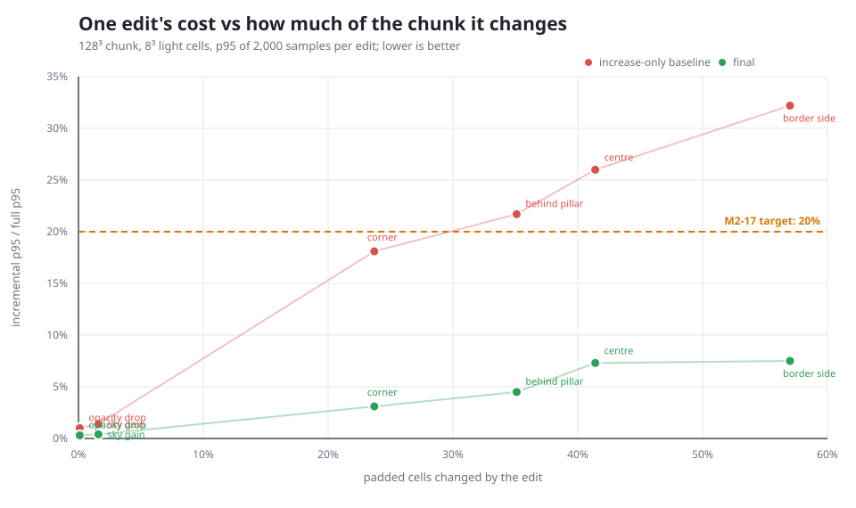
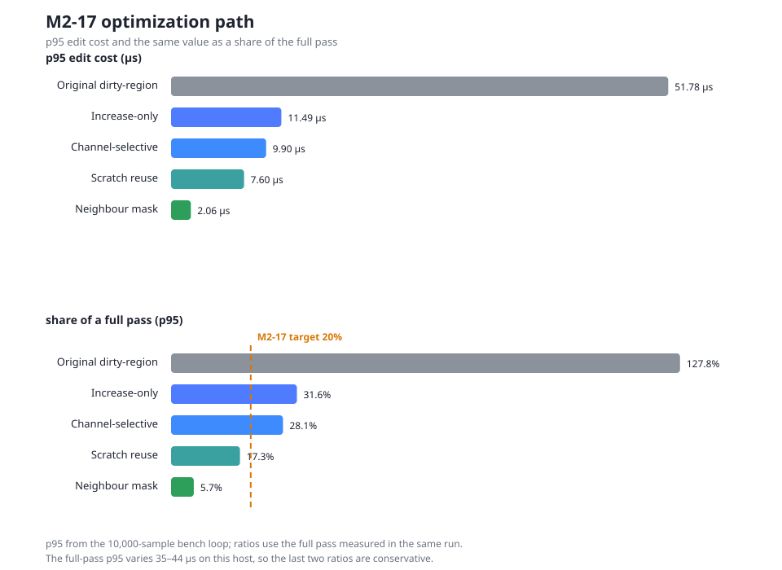

# M2-17 — Getting Incremental Light Below 20%

**Status:** Target met — 2026-10-29. The 128³ centre edit is **5.7% of a full
pass at p95** (7.0% at p50), down from the 31.6% recorded when M2-17 first
missed.
**Task:** M2-17, light border fixture and full-vs-incremental benchmark
**Host:** AMD Ryzen 5 7600, 4 vCPU visible (WSL2). Absolute times are a
development check; the ratios and the edit matrix are the result.

## Result

| Edge | Full p50 / p95 | Incremental p50 / p95 | Ratio p50 / p95 | Changed cells |
|---|---:|---:|---:|---:|
| 64³ (4³ cells) | 4.88 / 6.39 µs | 0.261 / 0.280 µs | 5.3% / **4.4%** | 46 / 216 |
| 128³ (8³ cells) | 28.81 / 36.12 µs | 2.00 / 2.06 µs | 7.0% / **5.7%** | 414 / 1,000 |

Criterion means from the same run: **5.25%** at 64³ (0.258 / 4.917 µs) and
**7.06%** at 128³ (2.037 / 28.857 µs). The task limit is incremental p95 ≤ 20%,
so the 128³ production edge clears it with a **3.5× margin**.

The result is not specific to the centre edit. The single-edit sweep below puts
every tested edit under 10% p95 at 128³, including the border-side edit that
changes 570 of 1,000 padded cells:

| Edit | Changed / 1,000 | p50 | p95 |
|---|---:|---:|---:|
| Centre emitter | 414 | 7.1% | 7.3% |
| Corner emitter | 237 | 4.2% | 3.1% |
| Border-side emitter | 570 | 9.5% | 7.5% |
| Behind pillar | 351 | 6.1% | 4.5% |
| Sky gain | 16 | 0.5% | 0.4% |
| Opacity drop | 1 | 0.4% | 0.3% |



## Where the time went

The pprof capture before the last two changes put ~98% of samples under
`apply_edits` → `propagate_seeded`; roughly **17%** of the run was bucket
`Vec<usize>` growth and `realloc`. The propagation inner loop also did
`coords_at` for every popped cell — two integer divisions and two modulo
operations — plus six bounds checks per neighbour.

After the changes the allocator has disappeared from the incremental graph. The
remaining samples are the propagation loop itself.

- [Final incremental flamegraph](profile/m2-17-light-incremental.svg)
- [Before the neighbour mask](profile/m2-17-light-incremental-before-table.svg)
- [Full-pass flamegraph](profile/m2-17-light-full.svg)

## The path, measured



1. **Increase-only fast path** (already landed before this report): when no
   edit removes light or increases opacity, propagate increases from the
   changed cells instead of reseeding and refilling the dirty region.
   `51.8 → 11.5 µs` p95, `127.8% → 31.6%`.
2. **Channel-selective propagation**: track whether the batch changed the block
   channel, the sky channel or both. An emitter edit no longer runs the sky
   pass, and a pure gain seeds only the edited cell rather than all six
   neighbours. `11.5 → 9.9 µs`, `31.6% → 28.1%`.
3. **Scratch reuse**: keep the 16 bucket vectors and the seed lists on
   `LightState`, clear them between edits, and give `clone_from` a custom
   implementation that preserves their capacity. No allocation per edit after
   warmup. `9.9 → 7.6 µs`, `28.1% → 17.3%`.
4. **Neighbour mask**: one byte per padded cell with a validity bit for each of
   the six directions, plus six constant index offsets. The inner loop becomes
   a mask test and an index add, with no coordinate division or bounds checks.
   `7.6 → 2.06 µs`, `17.3% → 5.7%`.

A 24 KB per-cell index table was the first version of step 4. It was within
noise of the mask for speed but tripled the state footprint, so the shipped
version is the **1 KB mask** (one byte per padded cell; 216 B at 64³, 1,000 B at
128³).

## Correctness

- `tests/light_increase.rs` pins emitter additions, opacity decreases, sky gains
  and apron edits to a fresh full pass, and asserts `full_relights() == 0`.
- `tests/light_incremental.rs` still matches a full recompute on 1,000 random
  edit sets, including removals and sky changes.
- `tests/light_escalation.rs` still proves boundary removals escalate.
- The benchmark asserts equality before and after the measured edit on every
  run and refuses to time an edit that escalates.
- The full `voxel-mesh` suite passes at both chunk edges.

## Trade-offs and limits

- Removals still escalate to a full relight at the production 4³/8³ grids. That
  is M2-16's correctness rule, not a gap in this work.
- The mask grows with the padded volume, not with the edit: 1 byte per cell.
  That is 1 KB at 128³ and 216 B at 64³ per `LightState`.
- The bucket and seed scratch keeps the largest edit's capacity per state. That
  is bounded by the padded volume and is not reallocated per edit.
- `LightState` now implements `Clone` with a capacity-preserving `clone_from`;
  the benchmark uses it to snapshot and restore a state between samples.
- The full-pass p95 is noisy on this host (35–44 µs across runs). Ratios are
  quoted against the full pass measured in the same run; the criterion means
  are the stable comparison.
- Re-run on the reference machine before quoting a gate number; the committed
  numbers are a development check.

## Reproduce

```sh
# headline p50/p95 and criterion means
cargo bench -p voxel-mesh --bench light

# the single-edit sweep (CSV)
LIGHT_MATRIX=1 cargo bench -p voxel-mesh --bench light -- --quick

# the flamegraphs
LIGHT_SKIP_P95=1 LIGHT_PROFILE=1 \
  cargo bench -p voxel-mesh --bench light -- \
  "light/edge_8/incremental_edit" --profile-time 10

# the SVG charts
python3 scripts/m2_17_charts.py
```

Raw data: [`profile/m2-17-matrix-before.csv`](profile/m2-17-matrix-before.csv),
[`profile/m2-17-matrix-after.csv`](profile/m2-17-matrix-after.csv),
[`profile/m2-17-phases.csv`](profile/m2-17-phases.csv).
Browser index: [`profile/m2-17-20pct.html`](profile/m2-17-20pct.html).
