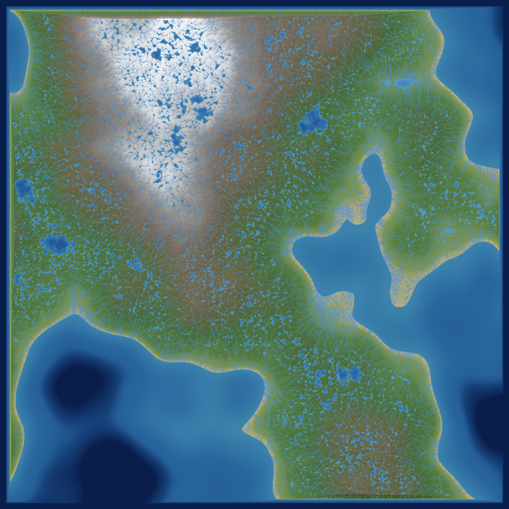

# Worldgen terrain preview

**Status:** captured 2026-11-01 from the real generator, not an illustration.



A full-world view of seed 1: the 8,000 × 8,000 cell macro heightfield at 128 m,
after the priority-flood hydrology pass, rasterised at 2,048 × 2,048 with
hypsometric colours, hill shading, rivers and lakes.

| Quantity | Value |
|---|---:|
| Seed | 1 |
| Preview | 2,048 × 2,048 px |
| Macro cells | 8,000 × 8,000 (1,024 km square) |
| Land fraction | 65.0% |
| Lake cells | 4.31% |
| Max flow accumulation | 5,497,690 |
| Elevation min / p50 / p90 / p99 / max | 23 / 7,002 / 10,049 / 11,608 / 11,957 m |
| Land elevation p50 / p90 / p99 / max | 7,750 / 10,759 / 11,705 / 11,850 m |

The sea level is 6,600 m. The dark blue regions are ocean and deep lakes, the
pale blue is the shallow shelf, the green/brown band is low and mid-altitude
land, and the white centre is the high alpine region. The fine blue threads are
river cells above the accumulation threshold; the blue patches are lakes at
their spill surfaces.

## Reproduce

The preview is rendered by the local `terrain_preview` working-tree example,
which builds the full heightfield, runs `Hydrology::compute` and writes the
PNG. The generator and hydrology it calls are committed; the preview helper is
a local rendering aid rather than part of the library path.

```bash
cargo run -p voxel-worldgen --release --example terrain_preview -- \
  --seed 1 --size 2048 --out docs/images/m2.5-world-preview-seed1-2048.png
```

The generation run printed:

```text
heights in 12.3s
hydrology in 12.8s: lake cells 4.31% max accumulation 5497690
raster in 180.8ms
```

## Scope

This is the macro geography only (128 m cells, hydrology). It does not yet show
chunk-scale detail, caves, overhangs or ore veins; those arrive with the chunk
pipeline (`M2.5-23`) and the later render previews.
